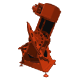

<div align="center">



# UltraScope Remote

**A night-vision-friendly iPhone remote for the UltraScope motorized telescope**

Slew, nudge, track and GOTO over Bluetooth Low Energy, with live direction and position reported back from the mount.

<p>
  
  
  <a href="LICENSE"></a>
</p>

</div>

---

## Features

| Feature | Description |
| --- | --- |
| **Direction pad** | Liquid Glass disc: tap to nudge one step, long-press to fast-move, center key to stop. |
| **GOTO** | Pick from the brightest objects above your horizon right now, or search 50 stars, 16 deep-sky objects, the Moon and the planets. Objects below the horizon or within 15° of the Sun can't be selected. |
| **Sync** | Swipe right on a target you've centered in the eyepiece and tap **Sync** so the mount knows where it's pointing. |
| **Tracking** | One button toggles sidereal tracking. The mount also starts tracking when a GOTO arrives. |
| **Live status** | Shows the mount's direction of motion, mode and current RA/Dec, plus errors such as a limit switch being hit. |
| **Night mode UI** | Dark, red-only interface throughout to protect your night vision. |
| **Preview mode** | Try the interface without hardware. |

## Hardware

- An iPhone running iOS 26 or later
- The UltraScope mount running [UltraScopeController](https://github.com/Thunor/UltraScopeController): an Arduino with ArduinoBLE and an Adafruit Motor Shield v2 driving two steppers (RA and Dec), with limit switches on both axes

The app scans for the controller, which advertises as **UltraScope**.

| Item | UUID |
| --- | --- |
| Service | `180A` |
| Command characteristic (write) | `2A57` |
| Status characteristic (notify) | `2A3D` |

## Using It

1. Tap **Not connected** and pick **UltraScope**.
2. Point the scope at a bright star by hand or with the pad.
3. Open **GOTO**, swipe right on that star, and tap **Sync**.
4. Pick any other target to slew to it. Tracking starts when it arrives.

Location access is needed so the app can work out what's above your horizon.

## Communication Protocol

The app and controller speak a small G-code dialect. Each command is one write to `2A57` and is 20 bytes or less, so it fits the default BLE MTU. Spaces and a trailing newline are optional.

| Command | Example | Description |
| --- | --- | --- |
| `G0 X±1` / `G0 Y±1` | `G0X-1` | Fast move RA (+ west / − east) or Dec (+ north / − south) until `M0` or a limit switch |
| `G0 A<ra> D<dec>` | `G0A05.9195D+07.4071` | GOTO equatorial coordinates of date (RA in hours, Dec in degrees). Needs a sync first |
| `G1 X<n>` / `G1 Y<n>` | `G1X1` | Nudge an axis `n` motor steps |
| `G92 A<ra> D<dec>` | `G92A05.9195D+07.4071` | Sync: the scope is centered on these coordinates |
| `M0` | | Stop, manual mode |
| `M100` / `M101` | | Tracking on / off |
| `M114` | | Report direction and position now |

The controller replies with notifications on `2A3D`, each 20 bytes or less:

| Message | Example | Description |
| --- | --- | --- |
| `D:<dir> M:<mode>` | `D:W M:TRK` | Direction of motion (`N S E W NE NW SE SW`, or `-` when still) and mode (`MAN TRK FST GTO`); sent whenever either changes |
| `P:<ra>,<dec>` | `P:05.9195,+07.4071` | Where the scope points, every 2 s once synced (`P:?` before) |
| `E:<code>` | `E:LIMIT` | Error: `BAD` (unknown command), `NOSYNC` (GOTO before sync) or `LIMIT` (limit switch hit) |

The controller has no position sensors yet: it works out its position by counting steps since the last sync.

## Build and Run

**Requirements:** Xcode 26 or later, a physical iPhone running iOS 26 or later

```bash
git clone https://github.com/Thunor/UltraScopeRemote.git
cd UltraScopeRemote
open UltraScopeRemote.xcodeproj
```

Select your iPhone in Xcode and press <kbd>⌘R</kbd>.

> [!NOTE]
> Bluetooth doesn't work in the Simulator. Enable **Preview mode** from the device picker to try the interface without hardware.

## Project Structure

```
UltraScopeRemote/
├── UltraScopeRemoteApp.swift   App entry point
├── ContentView.swift           Root view
├── BluetoothManager.swift      CoreBluetooth connection, command writes, status notifications
├── Models/
│   ├── ScopeProtocol.swift     G-code commands and controller status parsing
│   ├── CelestialObject.swift   GOTO catalog and per-observer sky positions
│   ├── Ephemeris.swift         Sun, Moon and planet positions, precession, sidereal time
│   ├── LocationProvider.swift  Observer location
│   ├── Direction.swift         Pad directions and their axis mapping
│   └── DriveHUD.swift          Command HUD state
├── Controls/                   Direction pad and its shapes
└── Screens/                    Remote, GOTO, device picker and settings screens
```

## Credits

Built on the [Robot Remote](https://github.com/robotctust/robot-bluetooth-remote-app-for-ios) app by the Robotic Research Club of CTUST. Ephemeris follows Paul Schlyter's *How to compute planetary positions*.

## License

Released under the [MIT License](LICENSE).

<div align="center">
<sub>© 2026 Eric Freitas · Made with SwiftUI</sub>
</div>
