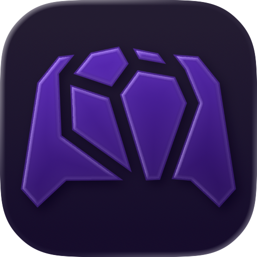

<div align="center">



# Robot Remote

**Control your Arduino robot car over Bluetooth**

An iOS app built with SwiftUI that remotely controls an Arduino robot car via Bluetooth Low Energy (BLE).<br>
Supports both analog joystick and disc directional-pad control modes, and lets you customize the command characters that are sent.

<p>
  
  
  
  <a href="LICENSE"></a>
</p>

</div>

---

## Features

| Feature | Description |
| --- | --- |
| **Joystick mode** | Analog joystick that converts to left/right wheel speeds in real time using differential mixing, reporting the vector at a fixed rate while dragging. |
| **Directional-pad mode** | A Liquid Glass-style disc with forward/back/left/right plus a central stop key. |
| **Command HUD overlay** | Dynamic Island-style overlay that shows the command currently being sent in real time. |
| **Custom commands** | Rewrite the ASCII character sent for each direction and the stop key, matching the recognition logic on the Arduino side. |
| **Preview mode** | Test the interface on a real device without connecting to hardware. |

## Hardware Requirements

- An iOS device
- An Arduino (this project was developed with an **Arduino Uno R4**)
- An **HC-08** BLE Bluetooth module (compatible with the HM-10)

| Item | Value |
| --- | --- |
| Service UUID | `FFE0` |
| Characteristic UUID | `FFE1` |

## Communication Protocol

The app sends ASCII strings to the Arduino over a BLE transparent serial link:

| Mode | Format | Example | Description |
| --- | --- | --- | --- |
| Directional pad | Single character | `F` `B` `L` `R` `S` | Forward / Backward / Turn left / Turn right / Stop (characters are customizable) |
| Directional pad | `V<rpm>\n` | `V50\n` | Sets the execution speed for directional-pad mode |
| Joystick | `M<L>,<R>\n` | `M50,-20\n` | Target RPM for the left and right wheels |
| GOTO | `G<RA>,<Dec>\n` | `G05.9195,+07.4071\n` | Slew to equatorial coordinates of date (JNow): RA in decimal hours (`HH.HHHH`), Dec in signed decimal degrees (`±DD.DDDD`) |

## Build and Run

**Requirements:** Xcode 16+ · iOS 26+ (uses new APIs such as Liquid Glass)

```bash
git clone https://github.com/robotctust/robot-bluetooth-remote-app-for-ios.git
cd robot-bluetooth-remote-app-for-ios
open RobotRemote.xcodeproj
```

Select a physical iOS device in Xcode, then press <kbd>⌘R</kbd> to run.

> [!NOTE]
> Bluetooth does not work in the simulator, so use a real device; alternatively, enable "Preview Mode" in the app's settings to test the interface.

## Project Structure

```
RobotRemote/
├── RobotRemoteApp.swift        App entry point
├── BluetoothManager.swift      CoreBluetooth connection management
├── ContentView.swift           Root TabView
├── Models/                     Data types (direction, control mode, HUD state)
├── Controls/                   Reusable control components (joystick, disc, Shape)
└── Screens/                    Individual screens (remote, settings, device picker)
```

## Contributing

Feel free to open an Issue to report problems or share ideas, and Pull Requests are welcome too:

1. Fork this project and create a branch (`git checkout -b feature/your-feature`)
2. Commit your changes (`git commit -m 'Add some feature'`)
3. Push the branch (`git push origin feature/your-feature`)
4. Open a Pull Request

## License

This project is released under the [MIT License](LICENSE).

<div align="center">
<sub>Copyright © 2026 Central Taiwan Robotics Club · Made with SwiftUI</sub>
</div>
